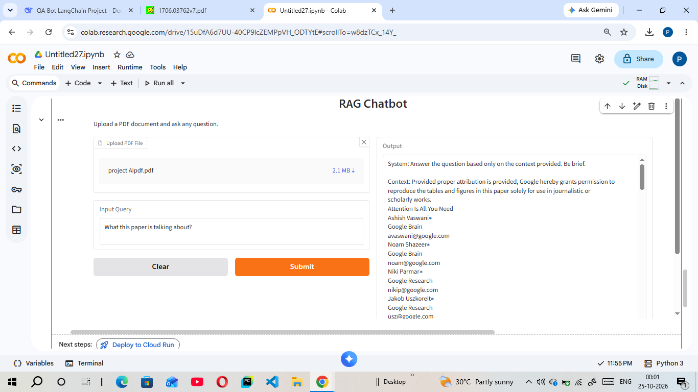

# RAG-QA-Bot-LangChain
A QA Bot built with LangChain, Hugging Face, and Gradio for document retrieval.
# RAG QA Bot using LangChain & Hugging Face

This project is a Retrieval-Augmented Generation (RAG) Question-Answering bot built as part of the Coursera IBM AI Engineering curriculum. 

## Overview
The bot allows users to upload a PDF document and ask questions based on its content. It uses LangChain to chunk the document, generates local embeddings via Hugging Face, stores them in a Chroma vector database, and uses a local LLM (`SmolLM2`) to generate accurate answers. The front-end is built using Gradio.

## Screenshots
Here is the Gradio web interface in action:

## How to Run
1. Open the `QA_Bot_Project.ipynb` file in Google Colab.
2. Run the first cell to install the required dependencies.
3. Run all subsequent cells to load the model and launch the Gradio app.
4. Click the generated `.gradio.live` public link to interact with the bot.

## Technologies Used
* **LangChain**
* **Hugging Face (Transformers & Embeddings)**
* **ChromaDB**
* **Gradio**
